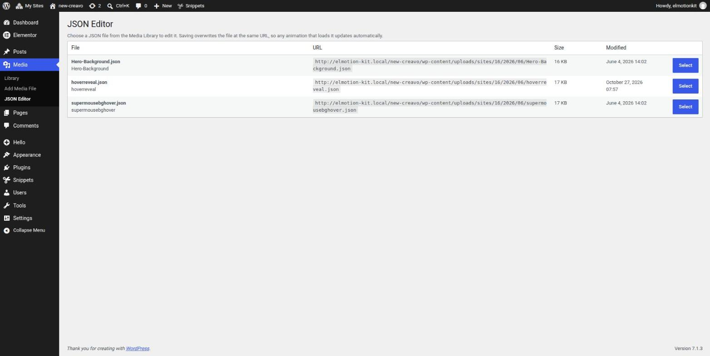
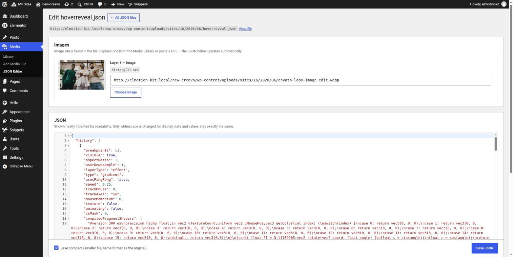
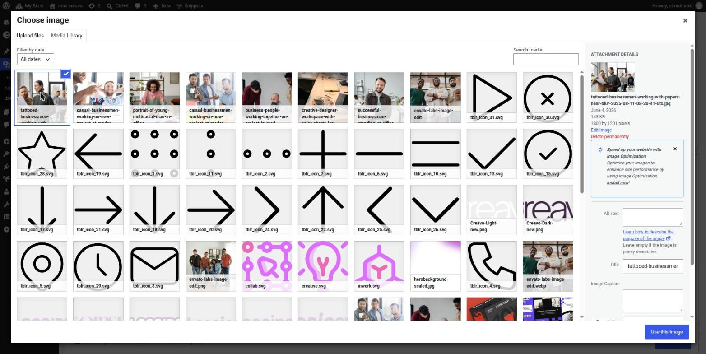
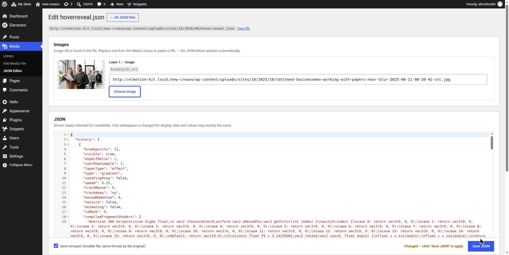
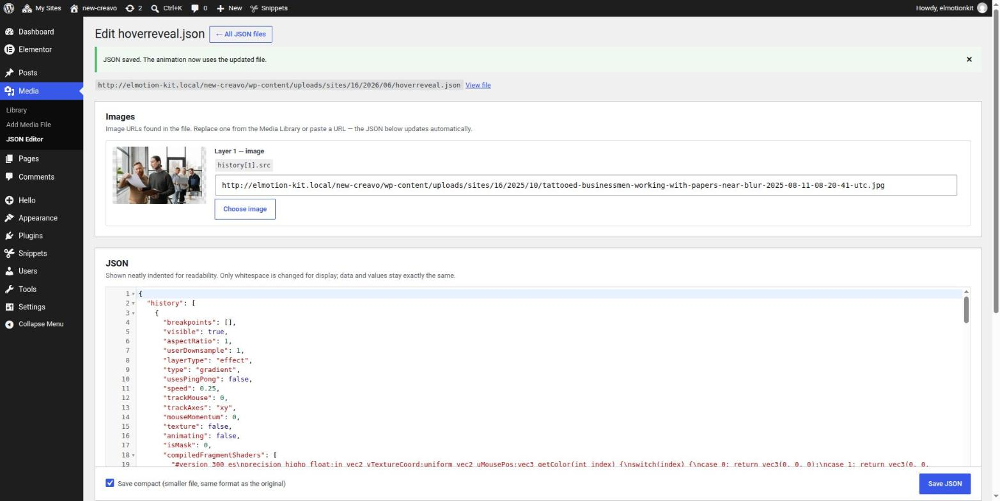
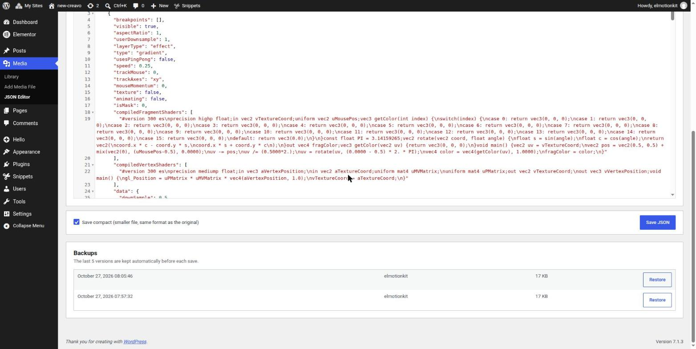
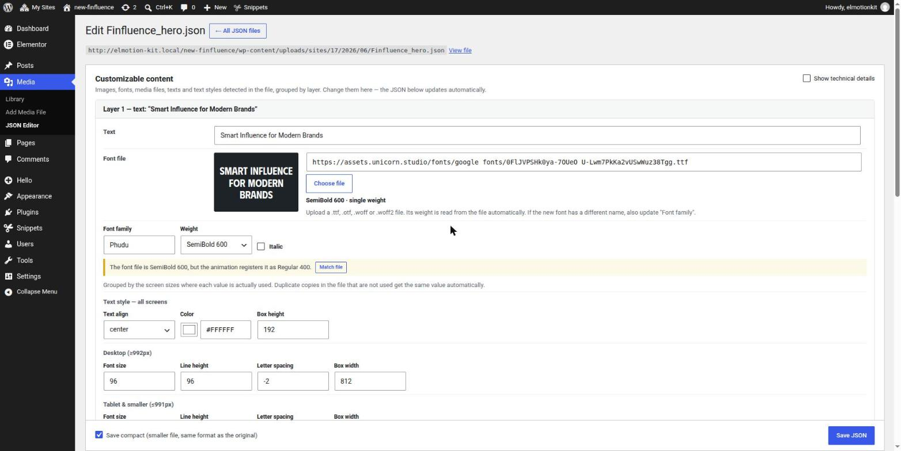

# JSON Media Editor

A WordPress plugin for editing JSON files in the Media Library from the dashboard. You don't need to download the file, edit it and upload it again.

It's built for animation tools that load their scene from an uploaded JSON file, such as **Unicorn Studio** (`data-us-project-src`) or **Lottie**. To change an image, font or text in the animation, edit it and click **Save**. The file is overwritten at the same URL, so the animation updates right away.

## Features

- **JSON files only.** The picker lists Media Library attachments with a `.json` extension, whatever their MIME type.
- **Customizable content panel.** Values are detected automatically and grouped by layer:
  - **Images.** Shown with a preview. Replace one from the Media Library or paste a URL. For Unicorn Studio image layers, `naturalWidth` / `naturalHeight` are updated to match the new image. Lottie image assets (`u` + `p`) are supported too.
  - **Fonts** (`.ttf`, `.otf`, `.woff`, `.woff2`). Shown with a live preview in the font itself. Copies of the font family name in the same layer (e.g. Unicorn's `fontFamily` and `fontCSS.family`) stay in sync, so the layer keeps using the loaded font.
  - **Weight and italic, made simple** (Unicorn Studio text layers). In Unicorn Studio, `fontStyle` sets how thick the text is drawn (`"600"`) or makes it italic (`"italic"`), and `fontWeight` is only the weight the font file is registered with. The editor replaces this pair with:
    - **Font file details.** The weight, italic and variable axis are read from the font file itself (TTF, OTF, WOFF), e.g. *SemiBold 600 · single weight*. Picking a new file registers it with its real weight automatically.
    - **Weight dropdown** (Thin 100 … Black 900) and an **Italic** checkbox. Unicorn Studio can't combine the two: italic text is always drawn at Regular 400, so the dropdown is disabled while Italic is on.
    - **Plain-language notes**, only when needed: when the weight is thinner than the file (it won't show, with a one-click *Use file weight*), when it's thicker (the browser thickens it artificially), when the file has no italic, or when the JSON registers the file with the wrong weight (*Match file*). Existing values are never changed without a click.
    - **A preview that matches the animation,** including synthetic bold or italic.
  - **Show technical details** reveals the raw keys and JSON paths for developers.
  - **Other media files.** Video, audio, JSON, 3D models.
  - **Texts.** For example Unicorn Studio `textContent` or Lottie text, with their style: font family, size, weight, line height, letter spacing, alignment, color and text box size. Styles are grouped by the screen sizes where each value is actually used, following Unicorn Studio's breakpoint rules:
    - A breakpoint applies when the screen is at most its `max` width. Its `min` is not checked, so the smallest breakpoint (e.g. Tablet ≤991px) also covers mobile.
    - Desktop applies to all wider screens.
    - The layer's own value is used only for properties that no breakpoint sets.

    Each property appears once per screen group. Copies in the file that are never used (e.g. a base `fontSize` identical to the Desktop one, or `fontFamily` + `fontCSS.family`) are updated along with it, so they never drift apart.
  - **Types are kept.** Numbers stay numbers and strings stay strings, so the animation reads values exactly as before.
- **Font uploads.** `.ttf`, `.otf`, `.woff` and `.woff2` files can be uploaded to the Media Library, checked by their font signature. To turn this off, use `add_filter( 'jme_allow_font_uploads', '__return_false' );`.
- **Readable editor.** Minified JSON is shown indented in the WordPress code editor (CodeMirror), with syntax highlighting, linting and folding. Only whitespace changes, so the data stays the same.
- **Compact save.** By default the file is saved minified, like the original. Opening a file and saving it without changes gives a byte-identical file.
- **Validation.** Invalid JSON is rejected in the browser and again on the server, so a broken file is never written.
- **Backups.** The last 5 versions are kept automatically and can be restored with one click.
- **Cache busting.** URLs of edited JSON files in post content and Elementor output get `?ver=<save time>`, so visitors don't see a cached animation.
- **Multisite.** Works per site on WordPress Multisite.
- **Access.** Users need the `upload_files` capability and permission to edit the attachment. Every action is nonce-protected.

## Requirements

- WordPress 5.9 or later
- PHP 7.4 or later

## Installation

1. Copy the `json-media-editor` folder to `wp-content/plugins/`, or upload it as a ZIP under **Plugins → Add New → Upload Plugin**.
2. Activate **JSON Media Editor**.

## Usage

1. Go to **Media → JSON Editor**. You can also use the **Edit JSON** link on a JSON file in the Media Library list view.
2. Click **Select** next to the file you want to edit.
3. In **Customizable content**, change a text, pick a new image or font with **Choose image** / **Choose file**, or adjust the text style. You can also edit the JSON directly in the editor.
4. Click **Save JSON**.

Examples:

- A hero section loads `hoverreveal.json` through Unicorn Studio. Swapping the image and saving changes the image-reveal animation straight away.
- A hero heading is a Unicorn Studio text layer in `Finfluence_hero.json`. Editing the text, font file and font family changes the animated heading.

## Screenshots

**1. Media → JSON Editor lists only the JSON files in the Media Library**



**2. Editor: the Images panel and the readable, indented JSON**



**3. Choose image opens the Media Library**



**4. The new image goes straight into the JSON, waiting to be saved**



**5. Saved: the animation now uses the updated file**



**6. Backups are kept automatically and can be restored with one click**



**7. Text layers: text, font file details, a simple Weight / Italic control with notes, and styles per screen size**



**8. Result: the animated heading uses the new text and font**


## Developer hooks

```php
// Runs after a JSON file has been saved or restored, e.g. to purge a page cache.
add_action( 'jme_json_saved', function ( $attachment_id, $path ) {
	// ...
}, 10, 2 );
```

## File structure

```
json-media-editor/
├── json-media-editor.php        Plugin bootstrap
├── includes/
│   ├── class-jme-files.php      Scanning, reading, validation, saving, backups
│   ├── class-jme-admin.php      Media → JSON Editor screens and save/restore handlers
│   ├── class-jme-frontend.php   ?ver= cache busting on the front end
│   └── class-jme-uploads.php    Font upload support (.ttf/.otf/.woff/.woff2)
├── assets/
│   ├── admin.js                 Editor, field detection, validation
│   └── admin.css
├── screenshots/                 README images (not included in the release ZIP)
├── readme.txt                   WordPress.org readme
└── uninstall.php                Removes plugin data (option + backups)
```

## Uninstall

Deleting the plugin removes its version option and the stored backups on every site. Your JSON files are left as they are.

## Author

[Djavaweb](https://djavaweb.com/)

## Contributors

- [fellixtara](https://github.com/fellixtara)

## License

GPL v2 or later. See <https://www.gnu.org/licenses/gpl-2.0.html>.
